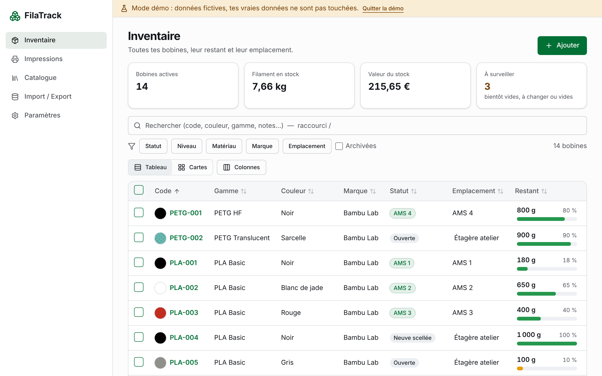
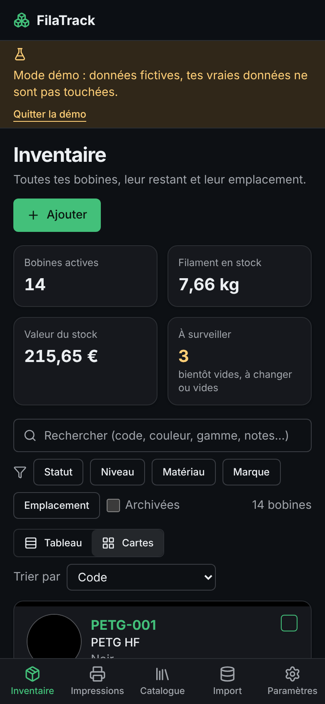

# FilaTrack

**Gestion de stock de filaments pour imprimante Bambu Lab A1 Combo (AMS lite).**
FilaTrack remplace un fichier Excel de suivi : inventaire des bobines, impressions et déductions automatiques (import `.3mf` / `.gcode`), mode pesée, vue AMS lite, journal de chaque modification, import/export Excel. Il est conçu pour être utilisé sur le téléphone à côté de l’imprimante comme sur l’ordinateur.

- 🔒 **100 % local** : les données restent dans le navigateur (IndexedDB). Rien n’est envoyé à un serveur.
- 📴 **Fonctionne hors ligne** une fois chargé ; la PWA installable complète arrive en phase 5.
- 🇫🇷 Interface en français, thème clair / sombre / système, accessible au clavier et aux lecteurs d’écran.

👉 **Application en ligne : https://blefebvre-lfbvrr.github.io/manage-filament/**

| Inventaire (tableau)                                                | Inventaire (cartes)                                                                  |
| ------------------------------------------------------------------- | ------------------------------------------------------------------------------------ |
|  |  |

| Fiche bobine et journal                            | Mobile (thème sombre)                                                       |
| -------------------------------------------------- | --------------------------------------------------------------------------- |
|  |  |

_Captures réalisées avec les données de démonstration._

## Fonctionnalités disponibles

**Inventaire**

- Vue tableau avec :
  - tri ;
  - recherche plein texte (raccourci `/`) ;
  - filtres combinés : statut, niveau, matériau, marque, emplacement ;
  - colonnes affichables ou masquables, mémorisées ;
  - édition en ligne du restant, du prix, de l’emplacement et des notes.
- Vue cartes avec la couleur réelle de chaque bobine. Les filaments translucides s’affichent sur un damier.
- Ajout rapide : on choisit la gamme puis la couleur du catalogue, et la tare, les températures et le prix habituel se préremplissent. La quantité permet d’ajouter « 4 × PLA Basic Noir » en une fois. Raccourci `n`.
- Duplication et actions groupées : statut, emplacement, duplication, archivage, suppression (annulable).
- Statut de la bobine : neuve scellée, ouverte, dans l’AMS (slots 1 à 4, un seul occupant par slot), support externe, vide, archivée.
- Niveau calculé automatiquement selon deux seuils paramétrables (globaux ou par bobine) : _OK → Bientôt vide → À changer → Vide_, comme dans l’Excel.
- Fiche bobine :
  - toutes les informations : achat, réglages, séchage, RFID, recharge, champs personnalisés ;
  - **journal des mouvements**, avec le solde après chaque mouvement ;
  - annulation de n’importe quel mouvement, qui ajoute un mouvement inverse ;
  - liste des impressions qui ont utilisé la bobine.

**Impressions et consommation** (phase 2)

- Saisie d’une impression avec plusieurs filaments (bobine principale et relais auto-refill). Les grammes sont déduits des bobines à l’enregistrement.
- **Raccourci « ratée à X % »** : seule la part déposée est déduite.
- **Import `.3mf` découpé (Bambu Studio) et `.gcode`** (Bambu Studio / OrcaSlicer), détaillé dans [docs/import-impressions.md](docs/import-impressions.md) :
  - poids et longueur par filament, durée, plateaux ;
  - **rattachement automatique** aux bobines (matériau, gamme, couleur, slot AMS) ;
  - **vérification du stock** avant l’enregistrement.
- **File d’attente** (« À imprimer ») : bouton _Imprimer_ pour lancer et déduire.
- Annulation de toute déduction : depuis l’impression, depuis le journal, ou en supprimant l’impression (annulable).
- Photo du résultat et fichier source conservables avec l’impression.
- **Mode pesée** : poids brut sur la balance − tare = restant réel, avec un historique des pesées. La page _Pesée_ permet d’enchaîner les bobines à l’atelier.
- **Vue AMS lite** : 4 slots et le support externe. Glisser-déposer, ou toucher la bobine puis le slot, ou menu _Placer_ (au clavier).
- **Journal global** des mouvements, avec filtres et annulation.

**Tableau de bord et coûts** (phase 3)

- Indicateurs : bobines et kg en stock, valeur du stock, consommation et dépenses de la période, coût moyen au kg, taux de réussite, bobines à surveiller.
- Graphiques (chacun a aussi une vue tableau accessible) :
  - consommation par jour, semaine ou mois ;
  - stock par matériau et **par couleur, avec les vraies couleurs** ;
  - dépenses par mois ;
  - coût par projet ;
  - filaments les plus utilisés.
- **Prévision de rupture** par bobine, d’après la consommation moyenne récente (fenêtre réglable).
- Sélecteur de période, filtres globaux (matériau, projet), widgets **réorganisables et masquables** (disposition enregistrée).
- **Projets** : budget avec jauge, coût cumulé, filament, impressions faites et à faire, reste à imprimer.
- **Coût électrique** optionnel (puissance moyenne × durée × prix du kWh), ajouté au coût des impressions et des projets.

**Alertes et réapprovisionnement** (phase 4)

- **Centre de notifications** (cloche avec badge) : bobines bientôt vides ou à changer, stocks minimum, séchage, pesées recommandées, sauvegarde. Notifications du navigateur en option.
- **Règles de stock minimum** par bobine, matériau, gamme, couleur ou gamme + couleur (« garder au moins 2 PLA Basic Noir »), en nombre de bobines ou en grammes.
- **Rappels de séchage** pour les matériaux hygroscopiques ouverts (PETG, TPU, ABS…), avec bouton « Séchée aujourd’hui » et température conseillée.
- **Liste de courses** :
  - suggestions automatiques (bobines vides ou à changer sans rechange, minimums non respectés) ;
  - prix d’après ton historique d’achat ;
  - lien vers la fiche produit ;
  - export texte et CSV ;
  - bouton « Acheté » qui ajoute les bobines au stock.
- **Vérification avant impression** : alerte de stock dans la saisie, l’import `.3mf` et la file d’attente.

**Projets** (phase 5)

- Projets **pour moi ou pour des tiers** (contacts réutilisables), statuts personnalisables, échéance, livraison, tags. Détails dans [docs/projets.md](docs/projets.md).
- **Pièces** depuis des `.3mf` découpés (plusieurs à la fois) ou saisies à la main, avec les quantités. **Avancement** calculé à partir des impressions rattachées.
- **Analyse de faisabilité** :
  - besoin avec marges ;
  - stock disponible, réservations des autres projets déduites ;
  - bobines identiques et alternatives proches ;
  - liste de commande ;
  - durée et date de fin.
- **« Puis-je imprimer ça ? »** sans créer de projet.
- **Réservation de bobines** pour un projet ; les réservations sont prises en compte dans les faisabilités.
- **Coûts** : matière réelle, ratés, électricité, machine, main-d’œuvre. **Prix suggéré** avec marge et arrondi, prix final, marge réelle, paiement. **Devis et récapitulatif** en PDF.
- Chiffre d’affaires et marge des projets pour des tiers.
- **Synchronisation** des projets, contacts et `.3mf` dans le dépôt privé `manage-filament-data` : hors ligne d’abord, conflits fusionnés sans perte.

**Données**

- **Import Excel**, détaillé dans [docs/import-excel.md](docs/import-excel.md) :
  - reconnaissance automatique des feuilles et des colonnes ;
  - écran de correspondance des colonnes ;
  - aperçu et détection des doublons ;
  - rapport d’erreurs téléchargeable ;
  - comparaison des restants recalculés avec ceux de l’Excel ;
  - correspondance des colonnes mémorisée pour les imports suivants.
- **Export** :
  - Excel avec 4 feuilles : Bobines, Impressions, Mouvements, Projets ;
  - CSV (séparateur `;`, compatible Excel français) ;
  - JSON complet.
- **Sauvegarde et restauration** JSON en un clic, avec un rappel de sauvegarde paramétrable. La restauration peut remplacer les données ou fusionner avec elles.
- **Données de démonstration** dans une base séparée : les activer ne touche pas aux vraies données.
- Catalogue modifiable : marques, gammes, couleurs (code hex et référence), tares, prix, températures, lien vers la fiche produit. Il est prérempli avec les gammes Bambu Lab courantes, mais ces valeurs sont **indicatives et à vérifier**.

## Installation (développement)

Prérequis : Node.js 22 (voir `.nvmrc`).

```bash
npm ci
```

```bash
npm run dev
```

Le site s’ouvre sur http://localhost:5173/manage-filament/.

| Commande                             | Rôle                                                 |
| ------------------------------------ | ---------------------------------------------------- |
| `npm run dev`                        | serveur de développement                             |
| `npm run build`                      | build de production dans `dist/`                     |
| `npm test` / `npm run test:coverage` | tests unitaires (Vitest), couverture sur `src/lib`   |
| `npm run e2e`                        | tests de bout en bout (Playwright, desktop + mobile) |
| `npm run lint` / `npm run format`    | ESLint / Prettier                                    |

> SheetJS (`xlsx`) est installé depuis `cdn.sheetjs.com`, car la version publiée sur npm est obsolète et vulnérable. Il faut donc que ce domaine soit accessible lors de l’installation.

## Utilisation

1. **Premier lancement** : importe ton Excel (page _Import / Export_), ajoute tes bobines, ou active la démo (_Paramètres_).
2. **Ajouter une bobine** : bouton _Ajouter_ (ou touche `n`), puis gamme et couleur. Pour une bobine déjà entamée, renseigne « Déjà consommé ».
3. **Corriger un restant** : depuis la fiche (_Corriger le restant_) ou directement dans la colonne _Restant_ du tableau. Chaque correction est tracée et annulable.
4. **AMS** : page _AMS_ ; glisse une bobine sur un slot. L’ancienne bobine du slot repasse automatiquement en « Ouverte ».
5. **Après une impression** : _Impressions → Importer .3mf / .gcode_. Vérifie les bobines proposées, puis _Enregistrer et déduire_. Sans fichier : _Nouvelle impression_.
6. **Peser** : page _Pesée_ (ou bouton _Peser_ sur la fiche). Saisis le poids brut ; la tare de la bobine est soustraite.

## Importer le fichier Excel existant

Page _Import / Export_ → _Importer un fichier Excel_ :

1. **Fichier** : glisse le `.xlsx`. Il est lu dans le navigateur et n’est envoyé nulle part.
2. **Colonnes** : vérifie la correspondance proposée. Les colonnes calculées (Restant, % restant, Statut…) servent uniquement à vérifier les valeurs recalculées. Les colonnes inconnues deviennent des champs personnalisés.
3. **Vérification** : choisis les options (garder les ID `B01`… comme codes, gestion des doublons, reprise des seuils), puis lis le rapport.
4. **Import** : tout est écrit en une seule transaction. Si quelque chose échoue, rien n’est importé.

Réimporter le même fichier est sans danger : les doublons sont ignorés par défaut.

## Sauvegardes

Les données vivent **dans ce navigateur, sur cet appareil**. Vider les données du site, ou passer en navigation privée, les efface. Sauvegarde régulièrement (_Import / Export → Sauvegarder (JSON)_) ; un bandeau te le rappelle tous les 14 jours, une fréquence réglable. La synchronisation optionnelle entre appareils (dépôt GitHub privé ou Gist) arrive en phase 6.

## Déploiement

Chaque push sur `main` déclenche `.github/workflows/deploy.yml`, qui lance les tests, construit le site et le publie sur GitHub Pages. **À activer une seule fois** dans _Settings → Pages → Build and deployment → Source : GitHub Actions_. Le routeur utilise des URL en `#/…`, ce qui permet au site statique de fonctionner sans réécriture d’URL.

`ci.yml` exécute le lint, le formatage, la vérification des types, les tests avec couverture, le build et les tests Playwright sur chaque push et chaque pull request.

## Synchronisation cloud Bambu Lab (facultative)

Une GitHub Action planifiée (toutes les 30 min) récupère l’historique des impressions de ton compte Bambu Lab via l’API cloud **non officielle**, et l’écrit dans le dépôt privé `manage-filament-data`. FilaTrack le récupère lors de la synchro et le propose dans **« À valider »** : bobine proposée par slot AMS puis par couleur, projet rattaché par préfixe `[CODE]`, échecs au prorata. Le stock n’est déduit qu’à la validation, une seule fois par impression. Un suivi temps réel MQTT est disponible en option (`npm run bambu-live`).

Mise en place, secrets à créer et **limites** (API non officielle, blocage Cloudflare possible, token de 3 mois…) : voir [sync-bambu/README.md](sync-bambu/README.md).

## Feuille de route

- [x] **Phase 1 — Socle** : modèle de données, inventaire, import/export Excel, sauvegarde, démo, déploiement.
- [x] **Phase 2 — Consommation** : impressions et file d’attente, import `.3mf` / `.gcode`, déductions et annulation, mode pesée, vue AMS, journal global.
- [x] **Phase 3 — Dashboard et coûts** : KPI, graphiques avec les vraies couleurs, prévision de rupture, projets, électricité.
- [x] **Phase 4 — Alertes** : seuils par matériau ou couleur, liste de courses, rappels de séchage, vérification avant impression, notifications.
- [x] **Phase 5 — Projets** :
  - pièces `.3mf`, avancement, faisabilité, réservations, liste de commande ;
  - coûts, prix, devis ;
  - stockage dans le dépôt privé.
- [x] **Phase 6 — Synchro cloud Bambu** :
  - script et GitHub Action ;
  - boîte de réception « À valider » ;
  - rattachement aux projets ;
  - option MQTT temps réel.
- [ ] **Phase 7 — Étiquettes** : QR codes, planches A4, scan par caméra, PWA complète, plaquette STL.
- [ ] **Phase 8 — Personnalisation** : gestion des champs personnalisés, vues enregistrées, widgets, palette Ctrl+K, synchronisation de toutes les données.

## Documentation

- [Modèle de données](docs/data-model.md)
- [Import Excel : règles de correspondance](docs/import-excel.md)
- [Import des impressions .3mf / .gcode](docs/import-impressions.md)
- [Module Projets : faisabilité, coûts, synchronisation](docs/projets.md)
- [CHANGELOG](CHANGELOG.md)

## Licence

[MIT](LICENSE)
