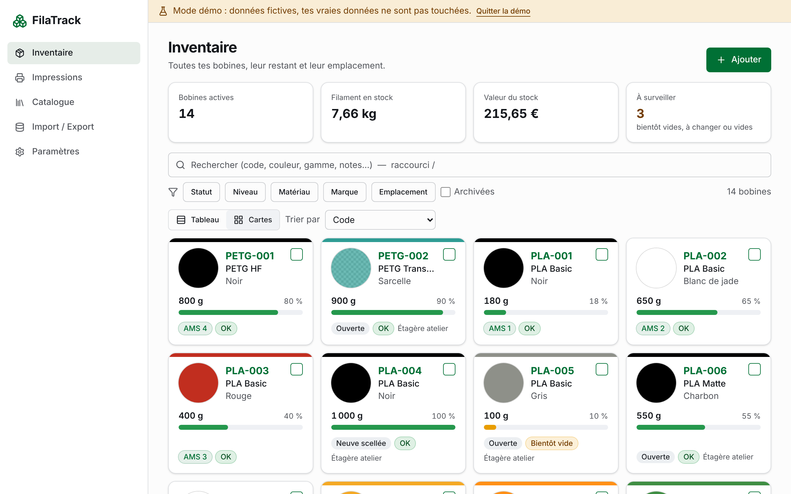
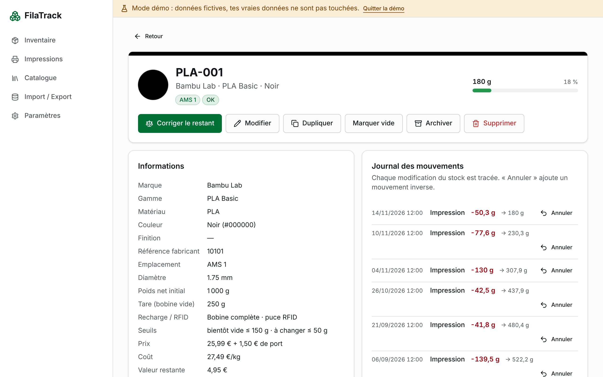

# FilaTrack

**Gestion de stock de filaments pour imprimante Bambu Lab A1 Combo (AMS lite).**
FilaTrack remplace un fichier Excel de suivi : inventaire des bobines, restant de chaque bobine, journal de chaque modification, import/export Excel. Il est conçu pour être utilisé sur le téléphone à côté de l’imprimante comme sur l’ordinateur.

- 🔒 **100 % local** : les données restent dans le navigateur (IndexedDB). Rien n’est envoyé à un serveur.
- 📴 **Fonctionne hors ligne** une fois chargé ; la PWA installable complète arrive en phase 5.
- 🇫🇷 Interface en français, thème clair / sombre / système, accessible au clavier et aux lecteurs d’écran.

👉 **Application en ligne : https://blefebvre-lfbvrr.github.io/manage-filament/**

| Inventaire (tableau)                                                | Inventaire (cartes)                                                                  |
| ------------------------------------------------------------------- | ------------------------------------------------------------------------------------ |
|  |  |

| Fiche bobine et journal                            | Mobile (thème sombre)                                                       |
| -------------------------------------------------- | --------------------------------------------------------------------------- |
|  |  |

_Captures réalisées avec les données de démonstration._

## Fonctionnalités disponibles (phase 1)

**Inventaire**

- Vue tableau avec :
  - tri ;
  - recherche plein texte (raccourci `/`) ;
  - filtres combinés : statut, niveau, matériau, marque, emplacement ;
  - colonnes affichables ou masquables, mémorisées ;
  - édition en ligne du restant, du prix, de l’emplacement et des notes.
- Vue cartes avec la couleur réelle de chaque bobine. Les filaments translucides s’affichent sur un damier.
- Ajout rapide : on choisit la gamme puis la couleur du catalogue, et la tare, les températures et le prix habituel se préremplissent. La quantité permet d’ajouter « 4 × PLA Basic Noir » en une fois. Raccourci `n`.
- Duplication et actions groupées : statut, emplacement, duplication, archivage, suppression (annulable).
- Statut de la bobine : neuve scellée, ouverte, dans l’AMS (slots 1 à 4, un seul occupant par slot), support externe, vide, archivée.
- Niveau calculé automatiquement selon deux seuils paramétrables (globaux ou par bobine) : _OK → Bientôt vide → À changer → Vide_, comme dans l’Excel.
- Fiche bobine :
  - toutes les informations : achat, réglages, séchage, RFID, recharge, champs personnalisés ;
  - **journal des mouvements**, avec le solde après chaque mouvement ;
  - annulation de n’importe quel mouvement, qui ajoute un mouvement inverse ;
  - liste des impressions qui ont utilisé la bobine.

**Données**

- **Import Excel**, détaillé dans [docs/import-excel.md](docs/import-excel.md) :
  - reconnaissance automatique des feuilles et des colonnes ;
  - écran de correspondance des colonnes ;
  - aperçu et détection des doublons ;
  - rapport d’erreurs téléchargeable ;
  - comparaison des restants recalculés avec ceux de l’Excel ;
  - correspondance des colonnes mémorisée pour les imports suivants.
- **Export** :
  - Excel avec 4 feuilles : Bobines, Impressions, Mouvements, Projets ;
  - CSV (séparateur `;`, compatible Excel français) ;
  - JSON complet.
- **Sauvegarde et restauration** JSON en un clic, avec un rappel de sauvegarde paramétrable. La restauration peut remplacer les données ou fusionner avec elles.
- **Données de démonstration** dans une base séparée : les activer ne touche pas aux vraies données.
- Catalogue modifiable : marques, gammes, couleurs (code hex et référence), tares, prix, températures, lien vers la fiche produit. Il est prérempli avec les gammes Bambu Lab courantes, mais ces valeurs sont **indicatives et à vérifier**.
- Historique des impressions et file « à imprimer » importés de l’Excel, en lecture seule pour l’instant.

## Installation (développement)

Prérequis : Node.js 22 (voir `.nvmrc`).

```bash
npm ci
```

```bash
npm run dev
```

Le site s’ouvre sur http://localhost:5173/manage-filament/.

| Commande                             | Rôle                                                 |
| ------------------------------------ | ---------------------------------------------------- |
| `npm run dev`                        | serveur de développement                             |
| `npm run build`                      | build de production dans `dist/`                     |
| `npm test` / `npm run test:coverage` | tests unitaires (Vitest), couverture sur `src/lib`   |
| `npm run e2e`                        | tests de bout en bout (Playwright, desktop + mobile) |
| `npm run lint` / `npm run format`    | ESLint / Prettier                                    |

> SheetJS (`xlsx`) est installé depuis `cdn.sheetjs.com`, car la version publiée sur npm est obsolète et vulnérable. Il faut donc que ce domaine soit accessible lors de l’installation.

## Utilisation

1. **Premier lancement** : importe ton Excel (page _Import / Export_), ajoute tes bobines, ou active la démo (_Paramètres_).
2. **Ajouter une bobine** : bouton _Ajouter_ (ou touche `n`), puis gamme et couleur. Pour une bobine déjà entamée, renseigne « Déjà consommé ».
3. **Corriger un restant** : depuis la fiche (_Corriger le restant_) ou directement dans la colonne _Restant_ du tableau. Chaque correction est tracée et annulable.
4. **AMS** : passe le statut à « Dans l’AMS » et choisis le slot. L’ancienne bobine du slot repasse automatiquement en « Ouverte ».

## Importer le fichier Excel existant

Page _Import / Export_ → _Importer un fichier Excel_ :

1. **Fichier** : glisse le `.xlsx`. Il est lu dans le navigateur et n’est envoyé nulle part.
2. **Colonnes** : vérifie la correspondance proposée. Les colonnes calculées (Restant, % restant, Statut…) servent uniquement à vérifier les valeurs recalculées. Les colonnes inconnues deviennent des champs personnalisés.
3. **Vérification** : choisis les options (garder les ID `B01`… comme codes, gestion des doublons, reprise des seuils), puis lis le rapport.
4. **Import** : tout est écrit en une seule transaction. Si quelque chose échoue, rien n’est importé.

Réimporter le même fichier est sans danger : les doublons sont ignorés par défaut.

## Sauvegardes

Les données vivent **dans ce navigateur, sur cet appareil**. Vider les données du site, ou passer en navigation privée, les efface. Sauvegarde régulièrement (_Import / Export → Sauvegarder (JSON)_) ; un bandeau te le rappelle tous les 14 jours, une fréquence réglable. La synchronisation optionnelle entre appareils (dépôt GitHub privé ou Gist) arrive en phase 6.

## Déploiement

Chaque push sur `main` déclenche `.github/workflows/deploy.yml`, qui lance les tests, construit le site et le publie sur GitHub Pages. **À activer une seule fois** dans _Settings → Pages → Build and deployment → Source : GitHub Actions_. Le routeur utilise des URL en `#/…`, ce qui permet au site statique de fonctionner sans réécriture d’URL.

`ci.yml` exécute le lint, le formatage, la vérification des types, les tests avec couverture, le build et les tests Playwright sur chaque push et chaque pull request.

## Pont imprimante (phase 7, optionnel)

Le dossier [`bridge/`](bridge/README.md) contiendra un petit script Node.js local. Il écoutera l’imprimante en MQTT (mode LAN) pour créer automatiquement les impressions terminées et suivre les slots AMS. L’application fonctionne parfaitement sans lui.

## Feuille de route

- [x] **Phase 1 — Socle** : modèle de données, inventaire, import/export Excel, sauvegarde, démo, déploiement.
- [ ] **Phase 2 — Consommation** :
  - saisie des impressions et file d’attente ;
  - import `.3mf` (Bambu Studio) et `.gcode` ;
  - déductions et annulation ;
  - mode pesée avec tare et historique des pesées ;
  - vue AMS en glisser-déposer.
- [ ] **Phase 3 — Dashboard et coûts** : KPI, graphiques avec les vraies couleurs, prévision de rupture, projets, électricité.
- [ ] **Phase 4 — Alertes** : seuils par matériau ou couleur, liste de courses, rappels de séchage, vérification avant impression, notifications.
- [ ] **Phase 5 — Étiquettes** : QR codes, planches A4, scan par caméra, PWA complète, plaquette STL.
- [ ] **Phase 6 — Personnalisation** : gestion des champs personnalisés, vues enregistrées, widgets, palette Ctrl+K, synchronisation GitHub.
- [ ] **Phase 7 — Pont MQTT** (optionnel).

## Documentation

- [Modèle de données](docs/data-model.md)
- [Import Excel : règles de correspondance](docs/import-excel.md)
- [CHANGELOG](CHANGELOG.md)

## Licence

[MIT](LICENSE)
